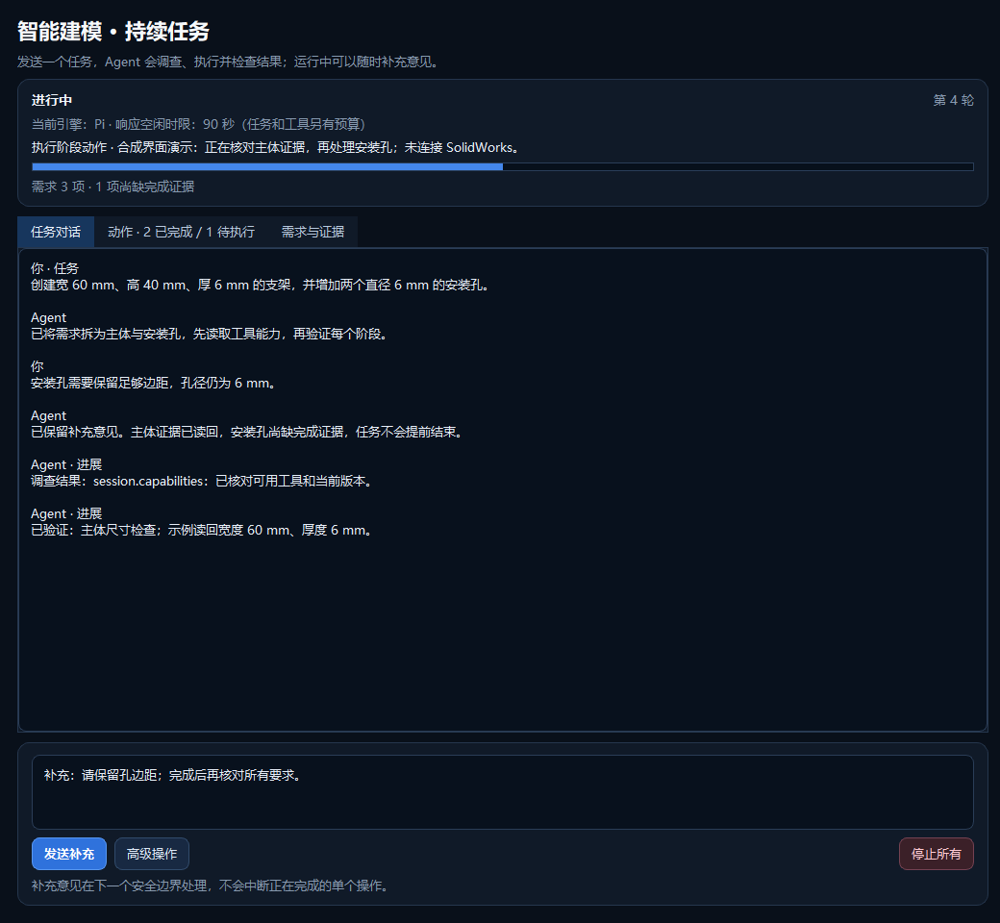
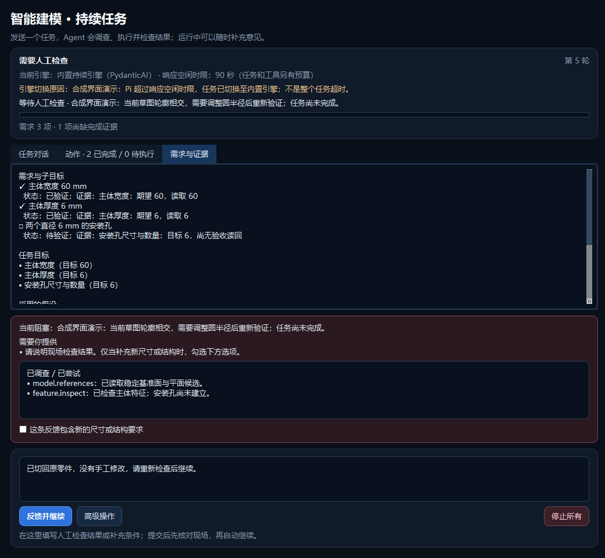

# 5.1.1：持续任务的恢复路径修正

日期：2026-09-06。目录：`SolidWorks-Assistant`。本轮为源码修复版本，不生成 EXE。
修复前基线为 `21e8e65`，标签 `v5.1.0-baseline`；本轮分支 `codex/v5.1.1-recovery`。

## 为什么需要这一轮

真实使用暴露的不是单一模型能力问题：Pi 尚在调查时被 90 秒整轮时限终止；后备引擎绘制的
相切圆未通过拉伸检查，活动草图没有可用的局部修改动作；“继续”被当作几何需求；自动诊断
重复读取又加速触发无进展保护。此前 413 项测试未覆盖这组真实组合，不能据此宣称复杂恢复已完成。
本轮不把原始用户任务、模型服务记录、凭据或 CAD 文件收入源码；测试使用同类合成场景。

## 修正内容

### 响应空闲、工具耗时、整轮预算分开

Pi 有实质文本/工具参数进展或受信调查结果时刷新响应空闲期限，纯空白、重复响应、心跳或
任意对话框请求不能续期。公开界面只显示正在响应，不输出隐藏推理内容。
宿主调查执行时间不作为模型空闲，但整轮仍有独立硬预算，防止无限输出。

默认响应空闲时限为模型配置的 90 秒，整轮预算为响应时限的 10 倍，最低 300 秒、最高 1800 秒。
达到整轮预算会暂停，不能把仍活跃的 Pi 当成失联而自动换引擎。真正运行时或响应故障下，
自动模式仍可切换一次到内置引擎，界面持续显示实际引擎与脱敏后的切换原因。
内置引擎也将单请求响应等待与整轮预算分开，保持取消、工具次数和输出预算。

### “继续”不是一项尺寸要求

精确匹配“继续”“请继续”“继续执行”“resume”“continue”等纯控制句，不生成几何需求，
即使误选了“这条反馈包含新的尺寸或结构要求”也一样处理。
包含新增结构或尺寸的文本不会按包含关键词粗暴过滤，例如“继续，把厚度改为 6 mm”仍属于补充要求。

旧记录中有原始用户消息可证实、且没有几何子要求的纯控制来源，可以在恢复时进行可审计分类：
原文、消息和原有指标保留，标记 `source_kind=control`，不再强迫它关联几何指标。
Agent 不能借此把真正的用户要求降级成控制消息。UI 单列控制消息，不计入缺失几何证据。

### 补上受控的圆半径修复

新增 `sketch.set_circle_radius(entity_ref, expected_radius_mm, radius_mm)`。
Agent 先通过 `sketch.inspect` 读取真实半径及可编辑引用，然后提交半径修改阶段；修改后再次检查
草图轮廓，再尝试拉伸。仍禁止在活动草图中嵌套创建另一个草图。

- 只允许本任务、本 Worker 会话内有创建证据的完整非构造圆；不是任意实体编辑器。
- 引用绑定文档、配置、草图和实体身份，不使用可变的枚举序号猜测对象。
- `expected_radius_mm` 必须与最新实测相符；先判断是否确实在修复预期现场。
- 使用官方 `ISketchArc.SetRadius`，修改前后读取完整的有界草图几何，确认圆心及其他实体没有被改变。
- 支持最多 128 个可完整读取的线/圆弧实体；未知类型、缺引用或截断结果不能冒充完整验证。
- false、异常、部分修改、身份变化或无法读回时保留现场并暂停，不盲目撤销，也不假装已经回滚。
- Windows COM 身份不能假设可直接哈希；使用保留实际 IUnknown 引用、最多 4096 项的宿主身份映射。
  身份读取失败会使整体观察标记为不完整，而不是默默继续普通写操作。

这是特定而实用的恢复能力，不代表已经支持任意草图删除、任意拓扑撤销、圆角、抽壳或自由曲面。

### 无进展计数与诊断更准确

候选/恢复策略的无进展次数与重复只读调查分别计数。宿主自动追加的诊断不再让一次无效提案
变成三次策略失败；主动调查仍有独立预算。真实几何或合同证据取得进展后重置局部恢复预算。
诊断摘要同时展示最近 CAD 失败和最新候选/合同拒绝，避免始终复述旧的几何错误。
无进展暂停提示也附上最后实际阻碍，不再只显示一个失败次数。

### 不再永久锁死猜测的参数名称

新提案中尚未实际观察到的尺寸/特征名称转为待绑定，不能把描述性名称当成真实 API 参数名称。
已验证的引用继续锁定；对历史上从未被真实观察支持的错误引用，可在保留测量指标、数值、
比较方式及容差的前提下，进行一次有实际观察证据且可审计的引用修复。
这不是放宽用户目标或把失败结果重新定义成成功。

## 当前窗口和旧任务怎么办

本轮没有关闭当前 GUI、重跑用户任务、操作现有 SolidWorks 文档或调用外部模型。
磁盘源码更新不会热替换正在运行的 Python 模块；新的时限、UI 和工具需退出旧 GUI 后重新启动
`run.bat` 才生效。

**当前旧任务不能承诺直接无条件接续。** 5.1 没有保存新工具要求的圆创建引用；Worker 重启后也不再
拥有原活动草图的可信操作上下文。仅根据圆心、半径看起来相同，不能推定拥有修改权限。
保留已有模型供人工处理；新任务能够取得完整创建证据后才适用自动半径修复。
恢复记录仍先核对现场，不会自动覆盖或重建用户模型。

## 验证与尚待验收

最终 `scripts/verify.ps1` 退出码 **0**：**487 项 Python 测试通过，201.78 秒**。
Ruff 全部通过，mypy 检查 79 个源文件通过，compileall 通过。第一轮 483 项之后补齐了最后的
身份读取、调查额度与暂停提示边界回归，最终数字以本段为准。

| 补充验证 | 实际证据 | 边界 |
| --- | --- | --- |
| 新恢复场景 | 合成三圆拉伸失败 → 修改指定半径 → 再次拉伸 → 本地验收通过 | 不等于新编辑 API 已在真实 SolidWorks 中完成实机测试 |
| 原生 Pi 流式响应 | 真实 Pi 进程对接本地模拟服务通过 | 没有提交真实用户任务给外部模型 |
| Windows COM 身份 | 真实中性 `Scripting.Dictionary` 多包装器身份测试通过 | 不涉及 CAD 文档 |
| SolidWorks SDK | 本机 Interop 元数据只读核对 SetRadius(double)→bool，以及 GetRadius/IsCircle/GetCenterPoint2/GetNormalVector | 静态签名不是几何执行验收 |
| C# Event Bridge | 既有测试二进制复测 8/8 通过 | 本轮未重新编译或注册插件 |
| 版本与源码内容 | editable 包及源版本均为 5.1.1；36 个提交文件已审计 | 排除真实运行记录、凭据、CAD 与可执行构建产物 |

执行 `scripts/verify.ps1`：包含静态检查、类型检查、语法检查和全量 Python 测试。
专项覆盖持续响应超过空闲时限仍正常返回、空白/心跳不续期、整轮硬限、后备原因和取消、
纯控制语句、旧记录分类、错误引用修复、圆编辑所有权、局部/未知修改和前后几何验证。

真实 Pi 的流式测试只连接 `127.0.0.1` 模拟服务，使用 3 秒响应空闲限制、持续 4 秒的分段响应验证
“整轮超过空闲时限但持续有内容时不误停”。COM 身份兼容性已使用不涉及 CAD 的真实 Windows
`Scripting.Dictionary` 验证。新增不可哈希、多包装器指向同一对象的回归，纠正纯假对象遗漏。
新圆半径修复使用合成 COM 与任务状态机，不占用用户当前 SolidWorks。
因此新 API 的 SolidWorks 实机编辑、外部模型的复杂任务表现，仍需另行隔离验收。

本轮仍保留“Pi 原生只读调查＋本地校验阶段写入”的架构，没有把任意 Shell、文件读写或直接 COM
权限开放给推理模型，也没有宣称已经等价于完整独立 Pi 客户端。后续应在稳定的恢复工具和回归
基础上再简化原生工具循环与本地调度之间的交接，而不是取消安全检查或无限增加重试。

## 界面证据

原生 Windows Qt，合成任务与假服务，未连接 SolidWorks 或外部模型。检查了中文、实际引擎、
切换原因、响应时限说明、默认未选的反馈复选框以及停止按钮。窄窗证据区域可滚动。

[窄窗口检查](v511-evidence/review-narrow.png)。
