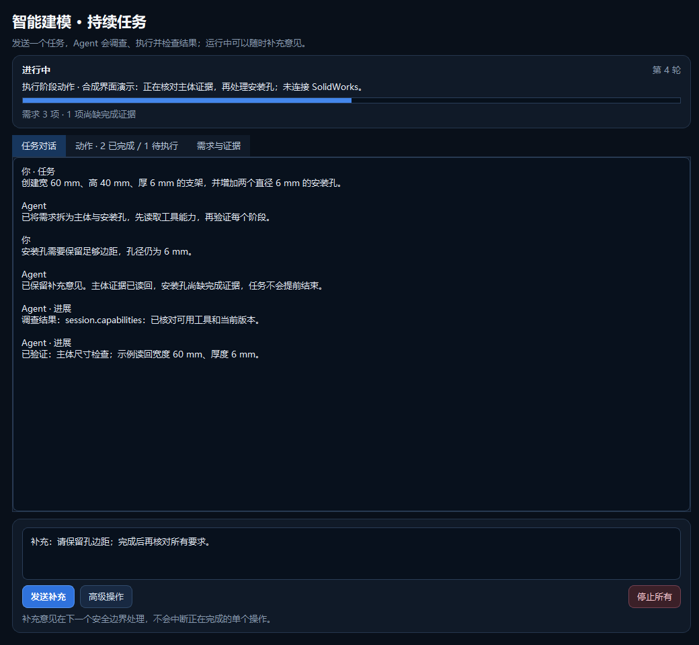
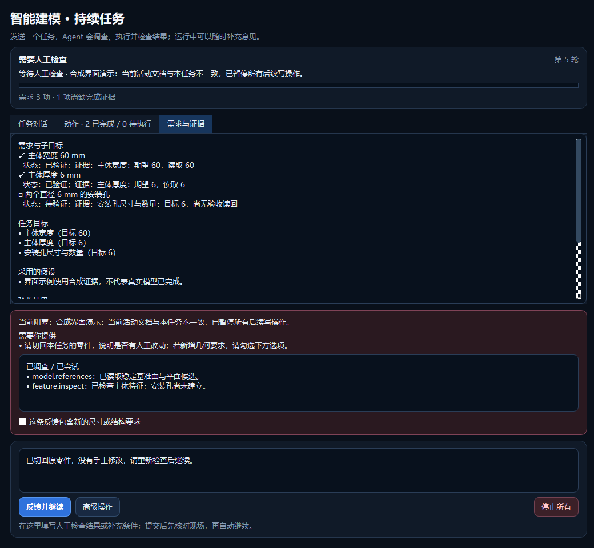

# 5.1 持续 Agent 工作台：迭代与验证报告

日期：2026-09-06。源码目录：`SolidWorks-Assistant`。版本：`5.1.0`。
本轮实现的是通用持续任务工作台，不是某个手机或产品的专用脚本。本报告区分自动测试、
真实进程通信、真实 CAD 联动和未验收能力，不能作为所有建模任务均成功的保证。

## 交付内容

1. 一次发送任务即可准备并持续执行；可以在运行过程中追加要求，下一安全边界接收并调整后续方案。
2. Pi 在同一个会话中原生调用受控只读调查工具，先取得证据再作阶段决策；后备引擎提供同名工具。
3. 新增能力查询、基准面/面引用、草图、特征和当前任务失败摘要调查。普通可恢复问题先排查，
   重复无进展、未知模型状态、可能部分修改、安全问题和关键人为决定仍明确暂停。
4. 原始需求、补充消息、子目标与实际几何指标建立关联；不能删除原目标、偷偷放宽精度，
   也不能只凭文档存在、模板基准面或实体数量声明完成。
5. 人工反馈一次提交即可核对并继续；新增结构/尺寸要求可显式纳入需求记录。全局停止常驻，
   恢复记录不会自动执行，晚到模型反馈不能覆盖停止状态或安全阻塞原因。
6. 保留已有模型库、参数派生、自动化、历史诊断和兼容固定计划入口；旧版本与数据目录不覆盖。

具体架构、工具边界及用户操作见 [工作台设计](V51_AGENT_WORKBENCH.md)。

## 最终自动验证

在独立 `.venv` 中运行 `scripts/verify.ps1`，退出码 **0**。

| 验证层面 | 实际结果 | 证据范围 |
| --- | --- | --- |
| Python 全量回归 | **413 passed，114.98 秒** | 包括原有兼容功能、新任务状态机、调查、UI、停止和打包规则回归 |
| Ruff | 全部通过 | `launcher.py`、`src`、`scripts`、`tests` |
| mypy | 78 个源文件通过 | `src` 与 `launcher.py` |
| compileall | 通过 | 源码、脚本与测试的语法/字节码检查；不是产品 EXE 编译 |
| 版本一致性 | 安装元数据与 `sw_assistant.__version__` 均为 `5.1.0` | 本地 editable 安装 |
| C# Event Bridge | 既有测试程序复测 **8/8** | C# 源码未变，本轮未重新构建或注册 Add-in |
| 桌面交互 | 原生 Windows Qt 测试及截图检查 | 使用合成任务/假服务，不等于外部模型复杂任务体验验收 |

重点回归覆盖：原生 Pi 连续两次调查后作决策、只暴露白名单工具、宿主同线程执行、参数与输出边界、
非有限数值拒绝、PydanticAI 工具消息配对、不同 Pi 进程消息隔离、停止后的晚到请求、
新任务取消代次、临近结束时追加要求、反馈新增需求、无进展暂停、需求来源和真实几何证据门禁。

最终全量运行前曾发现两项回归：旧假 Pi 协议未发送真实协议中的 `agent_start`；
无进展暂停后被普通调查反馈覆盖提示。前者补齐协议夹具，后者修复状态提示优先级并补充
review/completed/stopped 三态回归。上述问题已包括在最终 413 项通过结果中。

## 真实 Pi 与真实 SolidWorks 联动

脚本：`scripts/live_workbench_smoke.py --execute`。实际使用已安装 Pi **0.84.4**、
`127.0.0.1` 上的脚本化模拟模型服务、真实 SolidWorks STA Worker。
本次只新建未保存的测试零件，没有打开、保存或覆盖用户已有 CAD 文件。

| 项目 | 实际结果 |
| --- | --- |
| 流程 | 调查能力 → 新建零件 → 错误候选被本地拒绝 → 调查实际基准面 → 修正并建模 → 独立验收 |
| 结果与耗时 | `completed`，143.95 秒 |
| 外层决策 / 模型请求 | 4 轮 / 6 次本地请求，0 次外部模型请求 |
| 成功 CAD 动作 | 5 个 |
| 调查 | 4 次，全部返回成功；含原生工具调用和宿主自动诊断 |
| 被拒绝候选 | 1 个，`missing_plane` 在 CAD 执行前被本地策略拒绝 |
| 测试形体 | 20 × 10 × 10 mm 矩形棱柱 |
| 体积 | 预期 2000 mm³；读回 2000.0000000000002 mm³ |
| 最终检查 | 锁定目标、需求几何证据、文档、实体、无活动草图、无特征错误全部通过 |

这证明通信、调查、错误反馈、方案替换和真实执行的闭环成立。模型回复是预设序列，
**不证明外部大模型的自主规划质量**；错误基准面被提前拒绝，也不等同于真实 COM 几何失败后
已经通过任意拓扑回滚验收。棱柱测试使用体积验收，不代表仅凭体积可以验证复杂产品外观。

清理后的结果：[live-workbench.json](v51-evidence/live-workbench.json)。
SHA256：`5a2aac5ef3d7e5e10abcc9d9b82c36c1894aa70fb992db0d50b5e8fbab1eeeac`。
派生摘要的拒绝计数已按原始任务中一条 `policy_rejected` 记录校正；原始任务记录未改写。
原始本地调试记录位于 `artifacts/v51-live-workbench/`，不加入 Git，不作为对外提交的数据。

## 界面截图

以下为原生 Windows Qt 渲染的合成任务，不包含用户任务，也没有调用 CAD 或模型服务。
已检查中文、需求证据、反馈复选框和停止按钮；760 × 760 窄窗的证据区可滚动，操作区未被裁切。

[窄窗口检查](v51-evidence/review-narrow.png)。复现截图的本地脚本保留在 `artifacts/v51-ui/capture.py`。

## 回退、启动与剩余边界

5.0 源码基线：`2b6309d`，标签 `v5.0.0-baseline`。本轮分支：`codex/v5.1-agent-workbench`。
不要为回退覆盖用户数据；如需并行比较，应从基线建立另一工作目录，并避免两个程序同时操作 CAD。

关闭旧界面后运行 `run.bat`。本轮没有编译产品 EXE、生成安装包，
也没有更改旧版源码或用户既有任务以重新发起外部模型调用。

尚未完成：外部模型复杂任务评测、更多 SolidWorks 版本与真实拓扑故障恢复、圆角/抽壳等新增工具、
任意中间状态回滚、基于 CAD 模型截图的几何/外观验收、严格观察的性能优化，以及完整 Pi 运行时
随包发布和安装/卸载验证。
多轮 Agent 不是无限能力；已有精确目标冲突不能自动放宽，工具覆盖不足仍需要受控开发或人工处理。
