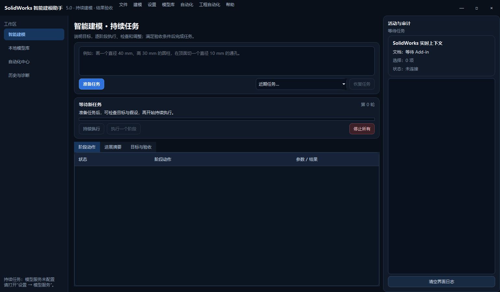
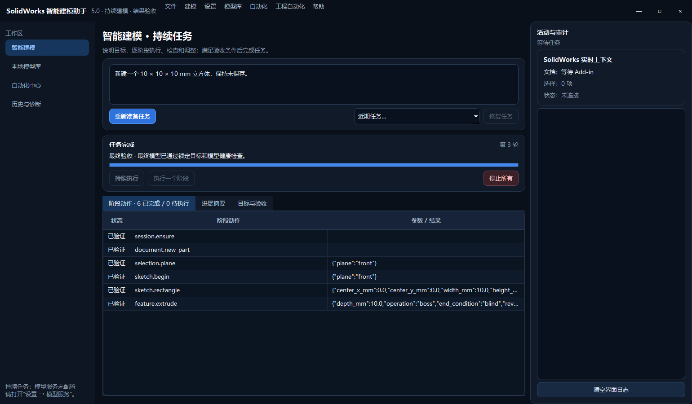

# V5.0 源码重构与验证记录

验证日期：2026-09-06。目录：`SolidWorks-Assistant`。版本：`5.0.0`。
本报告只描述本轮已取得的证据；不是任意模型可靠性、跨版本兼容或安装包发布认证。

## 本轮交付

- 从 V4.2 建立独立 V5 源码目录，旧 V3、V4.2 原目录保留。
- 持续任务成为默认入口：目标和假设、近期动作、成功/失败反馈、多轮决策、人工反馈、任务恢复。
- Pi 持久会话负责阶段决策；自动模式不可用时一次性切换内置 PydanticAI 持续会话，强制 Pi
  模式则明确报错。Agent 没有 Shell、任意代码、DLL、文件写入或直接 COM 权限。
- 本地白名单执行器独立检查动作、实际模型状态和最终目标，不能由模型自称成功替代验收。
- 新增只读 `model.observe`，读取文档、特征、可观察尺寸、基准面和选择；读取失败显式为未知。
- 统一停止、取消代次、迟到响应隔离、防重复提交；恢复任务和提交人工反馈不自动开始 CAD 操作。
- 独立用户数据目录，首次只复制旧配置/库/历史中尚未存在的目标文件，不覆盖旧数据。
- 部分导入失败后重试缺失目标，已存在目标保留并记录未解决冲突；源码打包排除凭据和任务数据。
- 保留兼容固定计划入口、本地模型库、参数派生、自动化中心和历史诊断。

## 验证结果

| 层面 | 方法 | 本轮结果 | 不能由此推出的结论 |
| --- | --- | --- | --- |
| Python 全量回归 | 独立虚拟环境运行 `scripts/verify.ps1` | **336 passed，69.97 秒** | 不等于任意 CAD 几何均可执行 |
| 静态与语法检查 | Ruff、mypy、compileall | 全部通过；mypy 检查 76 个源文件 | 不替代实机行为验证 |
| 任务状态机 | 39 项核心测试，包含在全量中 | 成功反馈、失败、停止、恢复、验收等通过 | 多种真实拓扑恢复尚需补测 |
| 真实 Pi 通信 | 实际 Pi 进程 + 127.0.0.1 模拟 SSE 模型 + 假 CAD Worker | 三轮 act → act → complete，保持同一会话；后续请求含实际步骤结果 | 未测外部模型的规划质量 |
| 真实 SolidWorks | 本地脚本决策器 + 真实 CAD Worker | 两阶段立方体，3 次决策、6 个成功动作，最终验收通过 | 未把外部模型与真实 CAD 串联验收 |
| C# Event Bridge | V5 新目录重新构建并运行测试 | 0 警告、0 错误，8/8 通过 | 未重新注册 Add-in，未做安装包验收 |
| 桌面 UI | 假服务交互测试 + 原生 Windows Qt 截图检查 | 中文、任务状态、动作、验收和操作入口可读 | 截图不是复杂任务使用体验测试 |
| 数据与源码包 | 6 项迁移测试 + 3 项实际 PowerShell 合成源码包测试，包含在全量中 | 失败重试、目标保护、运行数据过滤、清单与 SHA256 验证通过 | 不能替代每次发布时的实际内容审计 |

本轮测试没有向外部模型上传真实 CAD、日志或凭据。Pi 集成测试只使用本地模拟数据。
真实 SolidWorks 测试只新建未保存测试零件，没有保存或覆盖用户 CAD 文件；测试零件可能仍留在
当前 SolidWorks 会话中。基准测试记录的时长约 **204 秒**，观察频率的性能优化尚未完成。

## 真实 CAD 验收摘要

脚本：`scripts/live_v5_task_smoke.py`，必须显式传入 `--execute` 才会启动 CAD 操作。
该脚本的决策是本地预设序列，用于验证执行闭环，不用于证明大模型的建模能力。

1. 新建零件、选择稳定基准面、建立草图、绘制 10 mm × 10 mm 矩形。
2. 根据上一阶段的返回状态执行 10 mm 拉伸。
3. 再次读取实际模型，检查锁定目标和模型健康状态。

| 检查 | 预期 | 实际 |
| --- | --- | --- |
| 文档类型 | 零件 | 零件 |
| 实体数量 | 1 | 1 |
| 总体积 | 1000 mm³，容差 0.001 | 1000.0000000000001 mm³ |
| 活动草图 | 无 | 无 |
| 特征错误 | 无 | 无 |
| 任务创建的文档 | 是 | 通过 |

脱离原始任务记录的干净汇总保存在 [实机验收 JSON](v5-evidence/live-smoke-result.json)。
完整本地任务日志只保存在被 Git 忽略的 `artifacts` 下，不作为源码发布内容。

## 原生界面证据

下图由原生 Windows Qt 窗口生成；验收结果图在隔离 UI 数据目录重放本轮实机结果。
右侧连接状态反映截图环境，不代表截图进程正在控制实机模型。





## 已知边界与下一轮优先级

1. **性能**：逐动作前后严格观察成本明显。需先分解 COM 与观察耗时，再优化增量观察和阶段
   检查；不能直接去掉最终几何与文档身份验收。
2. **恢复**：完整特征检查点可以重新连接并核对后继续稳定基准面操作，不重放成功前缀。
   活动草图绑定和旧端面缓存不能跨 Worker 恢复；当前会明确暂停。部分生效的失败操作需要
   人工撤销到可核验状态，不能承诺任意自动回滚。
3. **停止**：阻止迟到模型结果、旧排队命令和已取消操作作用域继续发起新 CAD 调用；SolidWorks
   已受理的同步调用可能仍执行至返回，停止不等于撤销已做操作。
4. **观察与验收**：未被实际 API 枚举出的隐藏尺寸不能假定已读取；不可观察的必要目标不得通过。
   任意复杂曲面、任意装配流程和全部 SolidWorks 版本的兼容性尚未验收。
5. **模型质量**：本地 Pi 通信与真实 CAD 执行分别验证。复杂自然语言需求、外部模型差异以及
   真实多特征错误恢复仍需独立数据集，不应宣称增加 Agent 后必然完成建模。
6. **分发**：本轮是源码版；没有构建 V5 产品 EXE、安装包或便携包。Pi 使用本机已安装运行时，
   未随源码附带完整 Node/Pi 分发运行时。安装脚本已区分 V5 路径，发布前仍须隔离安装/卸载、
   冷启动和内容审计。共享 Event Bridge 未重新注册，避免覆盖旧版注册。
7. **隐私与迁移**：旧 DPAPI 凭据跨机器/用户无法直接使用；需重新输入。任务记录可能含本地模型
   名称、路径和参数，不应随源码打包。发给模型的是经裁剪/脱敏的任务上下文，不是权限扩展。

## 复现与交接

```powershell
cd SolidWorks-Assistant
.\scripts\verify.ps1
.\scripts\build_event_bridge.ps1
```

`requirements-validated.txt` 记录本轮 Windows x64 / Python 3.12.8 的实际依赖版本。
`run.bat` 使用项目独立 `.venv` 启动。Git 分支为 `codex/v5.0`，不关联远程仓库；旧工程保持原状。
后续开发先读 `README.md`、`CODEX-HANDOFF.md` 和 `docs/V5_ARCHITECTURE.md`。

Git 基线包含 210 个源码、测试及文档文件；提交前 `git diff --cached --check` 通过。
索引扩展名/文件名检查没有发现 CAD、数据库、日志、凭据文件或编译产物。忽略规则额外保护
虚拟环境、任务记录、设置、密钥相关文件及构建目录。没有配置远程仓库或上传代码。
